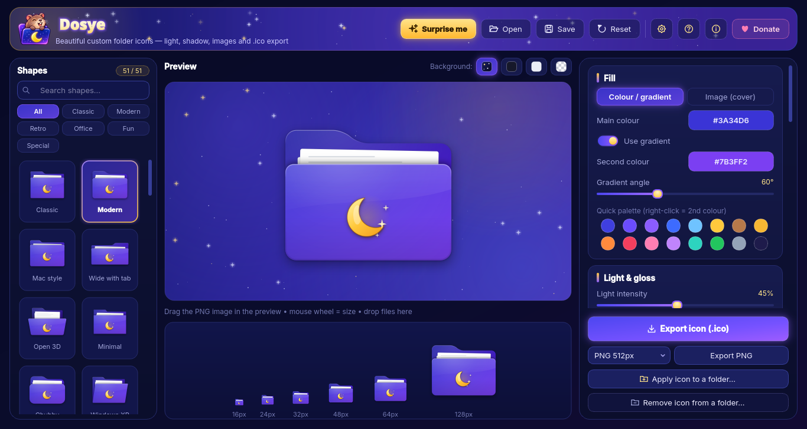
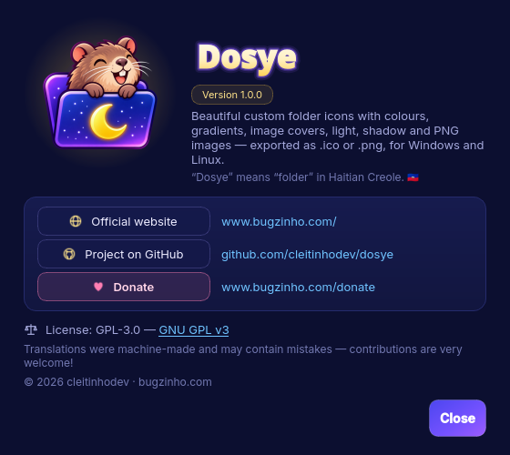
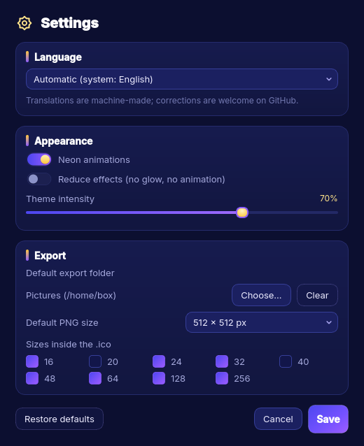
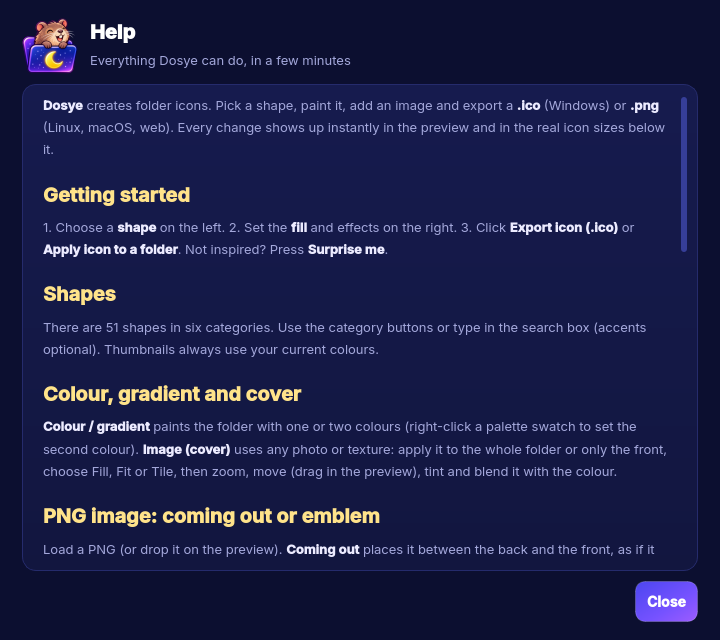

<p align="center">
  
</p>

<h1 align="center">Dosye</h1>

<p align="center">
  <b>Beautiful custom folder icons — light, shadow, images and <code>.ico</code> export.</b><br>
  <i>“Dosye” means “folder” in Haitian Creole 🇭🇹</i>
</p>

<p align="center">
  <a href="https://github.com/cleitinhodev/dosye/releases/latest"></a>
  <a href="https://github.com/cleitinhodev/dosye/actions/workflows/build.yml"></a>
  <a href="LICENSE"></a>
  
  
  
  
</p>

<p align="center">
  <a href="#download">Download</a> ·
  <a href="#features">Features</a> ·
  <a href="#build-from-source">Build</a> ·
  <a href="#languages">Languages</a> ·
  <a href="README.pt-BR.md">Português</a> ·
  <a href="#kreyòl-ayisyen">Kreyòl</a>
</p>

<p align="center">
  
</p>

Dosye is a small desktop app for designing folder icons. Pick one of **51 shapes**, paint it with colours,
gradients or a photo, add an image coming out of the folder (or printed on it as an emblem), tune light and
shadow, then export a multi-size **`.ico`** or a **`.png`** — or apply the icon to a folder in one click.

## Features

- **51 folder shapes** in six categories (classic, modern, retro, office, fun, special), with search.
- **Fill**: solid colour or two-colour gradient with angle, or an **image cover** (fill / fit / tile, zoom, position,
  tint, five blend modes, whole folder or front only) — six sample textures included.
- **PNG image** that *comes out* of the folder, or an **emblem** printed on the front (original colours, embossed
  or white silhouette), with position, size, rotation and shadow. Nine sample stickers included.
- **Light & shadow**: light intensity and direction, glossy finish, outer glow, drop shadow, inner shading,
  papers inside, frosted-glass front, outline, mirrored tab.
- **Export** `.ico` with any of 16 · 20 · 24 · 32 · 40 · 48 · 64 · 128 · 256 px, and PNG at 256 / 512 / 1024 px.
- **Apply to a folder** directly: Windows (`desktop.ini`), Linux GNOME Files / Nemo / Caja (GIO metadata) and
  KDE Dolphin (`.directory`) — and remove it again.
- **Presets** (`.dosye.json`, images embedded); old *Gerador de Pastas* `.pasta.json` presets open too.
- **Night-sky neon theme** drawn from the Dosye icon, with gentle animations that pause when the window is hidden
  and can be turned off (or *reduce effects* for slow PCs / remote desktop).
- **15 languages**, switchable at runtime, auto-detected on first run.
- Fits 1366×768 screens, including 125 % scaling.

<p align="center">
  
  
  
</p>

## Download

Grab the latest build from **[Releases](https://github.com/cleitinhodev/dosye/releases/latest)**:

| System | File | How to run |
| --- | --- | --- |
| Windows 10/11 (64-bit) | `Dosye-1.0.0-windows-x64.exe` | Double-click. Single portable file, no install. |
| Linux x86_64 | `Dosye-1.0.0-x86_64.AppImage` | `chmod +x Dosye-*.AppImage && ./Dosye-*.AppImage` |
| Linux x86_64 | `Dosye-1.0.0-linux-x86_64.tar.gz` | Extract, then `./dosye` — or `./install.sh` for a menu entry (no root). |
| Linux x86_64 | `Dosye-1.0.0-linux-x86_64` | Bare single-file binary: `chmod +x` and run. |

> **Windows SmartScreen:** the executable is not code-signed yet, so Windows may show
> “Windows protected your PC”. Click **More info → Run anyway**. You can always build it yourself from source.

## Build from source

Requirements: Python 3.9+ and the packages in `requirements.txt` (PySide6-Essentials and Pillow).

```bash
git clone https://github.com/cleitinhodev/dosye.git
cd dosye
python -m venv .venv && source .venv/bin/activate     # Windows: .venv\Scripts\activate
pip install -r requirements.txt
PYTHONPATH=src python -m dosye                         # Windows (PowerShell): $env:PYTHONPATH="src"; python -m dosye
# or install it:  pip install .   →   dosye
```

Packaging (needs `pip install -r requirements-dev.txt`):

```bash
bash scripts/build_linux.sh      # dist/Dosye-<v>-linux-x86_64, .tar.gz and .AppImage (NO_APPIMAGE=1 to skip)
bash scripts/build_windows.sh    # dist/Dosye-<v>-windows-x64.exe — on Windows (Git Bash) or on Linux through Wine
```

Pushing a `v*` tag runs [the build workflow](.github/workflows/build.yml), which builds both systems on GitHub
Actions and attaches the files to the release.

Useful flags: `--lang ht` (force a language), `--selftest DIR` (exports every shape, checks every language,
presets, folder icons, animations and layout, and writes `DIR/selftest.txt`), `--version`.

Project layout:

```
src/dosye/
  core/        rendering engine (render.py) and the 51 shapes (shapes.py)
  ui/          main window, widgets, dialogs, theme and effects
  i18n/        translation loader + locales/*.json
  system/      Windows / Linux folder-icon integration
  assets/      icons, sample covers, stickers, UI images
tools/         asset generators (stickers, textures, UI images)
scripts/       build_windows.sh, build_linux.sh
packaging/     PyInstaller launcher, Windows version info, Linux .desktop + install.sh
```

## Linux notes

- *Apply icon to a folder* writes a hidden `.dosye_icon_*.png` in the folder and sets it for
  **GNOME Files (Nautilus), Nemo and Caja** via `gio set <folder> metadata::custom-icon`, and for
  **KDE Dolphin** via the folder's `.directory` file. Reopen the folder window if it does not refresh.
- Thunar, PCManFM and some others don't support per-folder custom icons; Dosye tells you when it can't apply the
  icon — export a PNG and set it in your file manager instead.
- The tar.gz `install.sh` installs to `~/.local` (binary, menu entry and icon); `./install.sh --uninstall` removes it.
- Japanese, Chinese and Korean need a CJK font (e.g. `fonts-noto-cjk`), which most desktops already have.

## Languages

Kreyòl ayisyen · Français · Kréyòl Gwadloup / Matnik · Kreol Morisien · English · Português (Brasil) · Español ·
Deutsch · Italiano · Polski · Türkçe · Русский · 日本語 · 中文 (简体) · 한국어

Haitian Creole comes first: that's where the name comes from. **The translations were machine-made** and certainly
contain mistakes — native speakers are very welcome to fix them! Each language is a single JSON file in
[`src/dosye/i18n/locales/`](src/dosye/i18n/locales) with the same keys as `en.json`; run
`PYTHONPATH=src python -m dosye.i18n` to check for missing keys or placeholders, then open a pull request.
New languages are welcome too (add them to `LANGUAGES` in `src/dosye/i18n/__init__.py`).

## Contributing

Bug reports, ideas and pull requests are welcome in [Issues](https://github.com/cleitinhodev/dosye/issues).
Please run the self-test (`python -m dosye --selftest /tmp/dosye-test`) before sending code changes.

## Kreyòl ayisyen

**Dosye** se yon ti pwogram pou kreye bèl ikòn dosye: chwazi youn nan 51 fòm, mete koulè, degrade oswa yon foto,
ajoute yon imaj k ap soti nan dosye a, epi ekspòte yon `.ico` oswa yon `.png` — oswa mete ikòn nan sou yon dosye
dirèkteman. Non an soti nan mo kreyòl “dosye”. Tradiksyon yo fèt ak machin; si w pale kreyòl, ede nou korije yo! 💜

## Links

- 🌐 Official website: <https://www.bugzinho.com/>
- 💻 Project: <https://github.com/cleitinhodev/dosye>
- 💜 Donate: <https://www.bugzinho.com/donate>

## License

Dosye is free software: you can redistribute it and/or modify it under the terms of the
**GNU General Public License v3.0 or later** — see [LICENSE](LICENSE).

© 2026 cleitinhodev · [bugzinho.com](https://www.bugzinho.com/)
