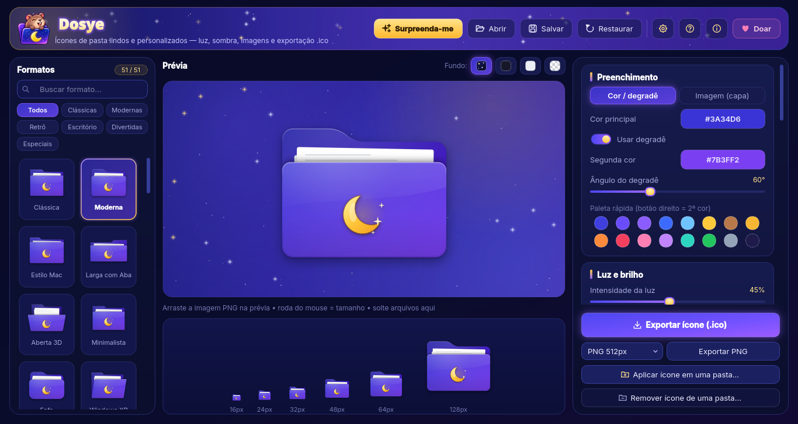
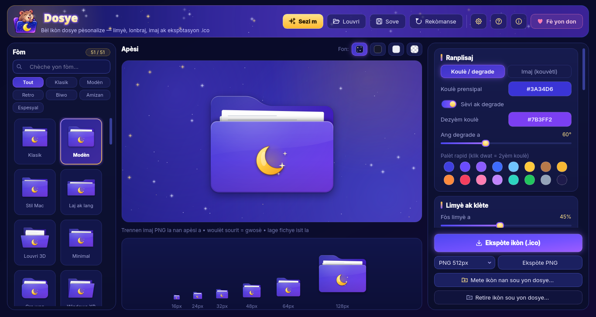
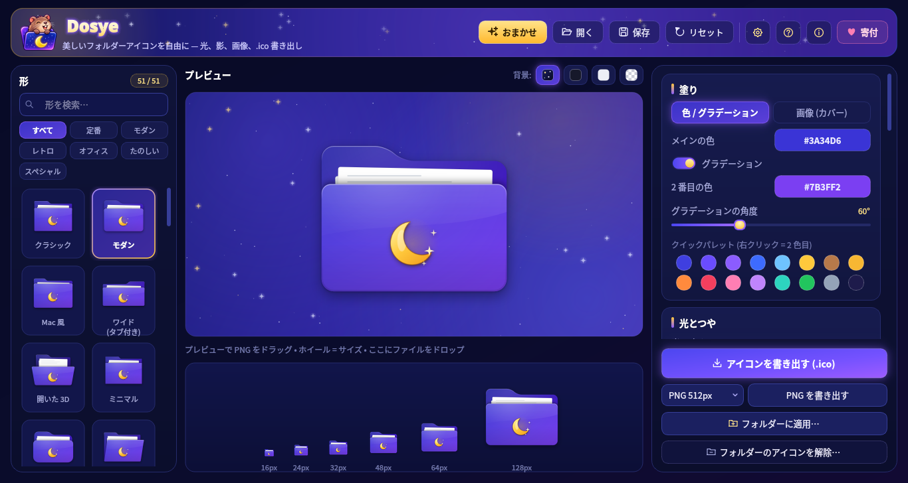

<p align="center">
  
</p>

<h1 align="center">Dosye</h1>

<p align="center">
  <b>Ícones de pasta lindos e personalizados — luz, sombra, imagens e exportação <code>.ico</code>.</b><br>
  <i>“Dosye” significa “pasta” em crioulo haitiano 🇭🇹</i> · <a href="README.md">English</a>
</p>

<p align="center">
  <a href="https://github.com/cleitinhodev/dosye/releases/latest"></a>
  <a href="https://github.com/cleitinhodev/dosye/actions/workflows/build.yml"></a>
  <a href="LICENSE"></a>
  
  
</p>

<p align="center">
  
</p>

O Dosye é um programa para criar ícones de pasta. Escolha um dos **51 formatos**, pinte com cores, degradês ou
uma foto, adicione uma imagem saindo da pasta (ou estampada como emblema), ajuste luz e sombra e exporte um
**`.ico`** com vários tamanhos ou um **`.png`** — ou aplique o ícone direto numa pasta.

## Recursos

- **51 formatos** em seis categorias (clássicas, modernas, retrô, escritório, divertidas, especiais), com busca.
- **Preenchimento**: cor sólida ou degradê de duas cores com ângulo, ou **imagem de capa** (cobrir / ajustar /
  lado a lado, zoom, posição, tingimento, cinco modos de mistura, pasta inteira ou só a frente) — com seis texturas de exemplo.
- **Imagem PNG** *saindo* da pasta ou **emblema** na frente (cores originais, gravado ou silhueta branca), com
  posição, tamanho, rotação e sombra. Nove figurinhas de exemplo.
- **Luz e sombra**: intensidade e direção da luz, acabamento brilhante, brilho externo, sombra projetada,
  sombreamento interno, papéis dentro, frente de vidro fosco, contorno e aba espelhada.
- **Exportação** `.ico` (16 a 256 px, você escolhe os tamanhos) e PNG 256 / 512 / 1024 px.
- **Aplicar numa pasta**: Windows (`desktop.ini`), Linux GNOME Arquivos / Nemo / Caja (metadados GIO) e
  KDE Dolphin (`.directory`) — e remover depois.
- **Predefinições** (`.dosye.json`, com as imagens embutidas); abre também os `.pasta.json` do antigo *Gerador de Pastas*.
- **Tema noite estrelada neon** com animações suaves que pausam quando a janela fica oculta e podem ser
  desligadas nas Configurações (ou “reduzir efeitos”).
- **15 idiomas**, troca na hora, detecção automática na primeira execução.
- Cabe em telas 1366×768, inclusive com escala de 125 %.

<p align="center">
  
  
</p>

## Download

Baixe em **[Releases](https://github.com/cleitinhodev/dosye/releases/latest)**:

| Sistema | Arquivo | Como usar |
| --- | --- | --- |
| Windows 10/11 (64 bits) | `Dosye-1.0.0-windows-x64.exe` | Dois cliques. Arquivo único e portátil, sem instalação. |
| Linux x86_64 | `Dosye-1.0.0-x86_64.AppImage` | `chmod +x Dosye-*.AppImage && ./Dosye-*.AppImage` |
| Linux x86_64 | `Dosye-1.0.0-linux-x86_64.tar.gz` | Extraia e rode `./dosye` — ou `./install.sh` para criar o atalho no menu (sem root). |
| Linux x86_64 | `Dosye-1.0.0-linux-x86_64` | Binário único: `chmod +x` e execute. |

> **SmartScreen do Windows:** o executável ainda não tem assinatura digital, então o Windows pode mostrar
> “O Windows protegeu o computador”. Clique em **Mais informações → Executar assim mesmo**.

## Compilar a partir do código

```bash
git clone https://github.com/cleitinhodev/dosye.git
cd dosye
python -m venv .venv && source .venv/bin/activate     # Windows: .venv\Scripts\activate
pip install -r requirements.txt
PYTHONPATH=src python -m dosye
```

Pacotes: `pip install -r requirements-dev.txt` e depois `bash scripts/build_linux.sh` ou
`bash scripts/build_windows.sh` (no Windows pelo Git Bash, ou no Linux via Wine). Ao enviar uma tag `v*`, o
GitHub Actions compila os dois sistemas e anexa os arquivos à release.

## Notas para Linux

- “Aplicar ícone em uma pasta” grava um `.dosye_icon_*.png` oculto na pasta e o define para **GNOME Arquivos,
  Nemo e Caja** (`gio set … metadata::custom-icon`) e para o **KDE Dolphin** (arquivo `.directory`).
- Thunar, PCManFM e outros não suportam ícone por pasta; nesse caso o Dosye avisa — exporte um PNG e defina no
  seu gerenciador de arquivos.
- Japonês, chinês e coreano precisam de uma fonte CJK (ex.: `fonts-noto-cjk`).

## Idiomas e traduções

Kreyòl ayisyen · Français · Kréyòl Gwadloup / Matnik · Kreol Morisien · English · Português (Brasil) · Español ·
Deutsch · Italiano · Polski · Türkçe · Русский · 日本語 · 中文 (简体) · 한국어

**As traduções foram feitas por máquina** e com certeza têm erros — correções de falantes nativos são muito
bem-vindas! Cada idioma é um JSON em [`src/dosye/i18n/locales/`](src/dosye/i18n/locales); rode
`PYTHONPATH=src python -m dosye.i18n` para conferir chaves faltando e abra um pull request.

## Links

- 🌐 Site oficial: <https://www.bugzinho.com/>
- 💻 Projeto: <https://github.com/cleitinhodev/dosye>
- 💜 Doações: <https://www.bugzinho.com/donate>

## Licença

O Dosye é software livre, distribuído sob a **GNU General Public License v3.0 ou posterior** — veja [LICENSE](LICENSE).

© 2026 cleitinhodev · [bugzinho.com](https://www.bugzinho.com/)
